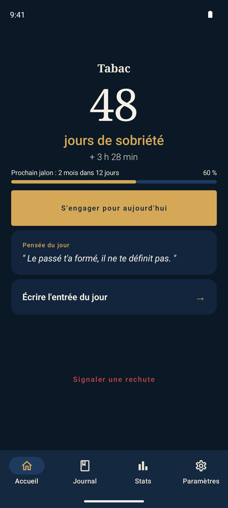
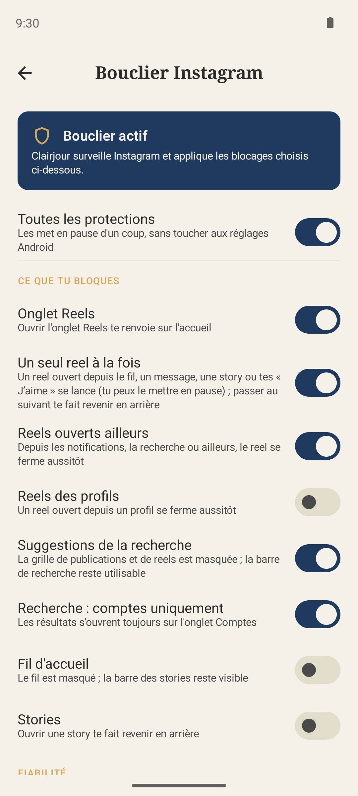
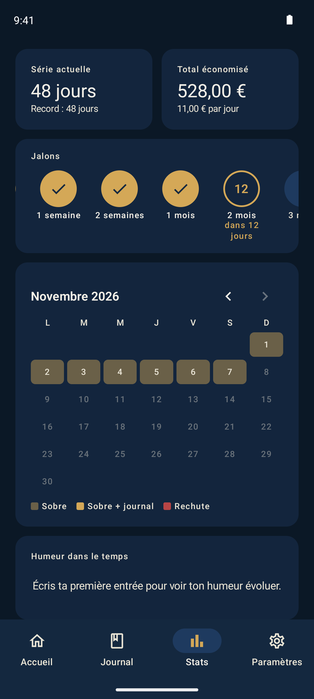

# Clairjour

[](https://github.com/Floran-grmxx/clairjour/releases/latest) [](LICENSE)

Application Android de suivi de sobriété multi-addictions — compteur temps réel, journal, jalons animés, statistiques, sauvegarde locale chiffrée, et bouclier anti-scroll pour Instagram.

## Captures

<p align="center">
  
  
  
</p>

## Télécharger

📦 [Dernier APK](https://github.com/Floran-grmxx/clairjour/releases/latest) (Android 8.0+)

## Fonctionnalités

- **Multi-addictions** — suivre plusieurs domaines en parallèle (tabac, alcool, sucre, écrans, etc.).
- **Accueil épuré** — compteur de jours + heures/minutes, barre continue vers le prochain jalon avec pourcentage, engagement du jour.
- **Journal** — entrées regroupées par semaine, recherche insensible aux accents, filtres humeur/envies, couleur selon l'humeur, swipe-to-dismiss avec confirmation.
- **Statistiques** — série et record, économies (total et par jour), frise de jalons, calendrier mensuel sobre / journal / rechute, humeur et déclencheurs fréquents.
- **Jalons animés** — 1/3/7/14/30/60/90/180/365 jours + célébration overlay quand un jalon tombe.
- **Rechute + undo** — bouton direct sur la Home, snackbar d'annulation avec restauration des milestones.
- **Numéros d'écoute** — 3114 et Drogues Info Service accessibles depuis les Paramètres.
- **Backup chiffré** — export/import JSON local, chiffrement AES-256/GCM + PBKDF2 (210k iters), passphrase utilisateur.
- **SQLCipher** — base Room chiffrée, clé stockée dans `EncryptedSharedPreferences`.
- **i18n** — FR/EN, sélecteur in-app (lit `LocalConfiguration.current`, jamais `Locale.getDefault()`).
- **Widget Home + notifications** privées (`VISIBILITY_SECRET`).
- **Bouclier Instagram** — service d'accessibilité qui bloque l'onglet Reels, les reels ouverts ailleurs (un seul reel partagé en message ou en story), la grille Explorer (masquée, raccourci « Chercher un compte »), force la recherche sur l'onglet Comptes ; fil et stories en option. Règles modulables, rien n'est enregistré ni envoyé. Une pastille sur l'onglet Paramètres signale un bouclier coupé par le téléphone.

## Stack

Kotlin 2.1 · Jetpack Compose (BOM) · Room + SQLCipher · DataStore (multi-processus pour le bouclier) · AccessibilityService · WorkManager · Glance widget · AGP 9.1 · Java 17. APK release ~13 Mo (bibliothèques natives ARM uniquement).

Pas de DI (ni Hilt ni Koin) — injection manuelle via `AppContainer`.

## Build

```bash
./gradlew assembleDebug
./gradlew installDebug
```

APK à jour dans [Releases](../../releases/latest).

Build release signé : `keystore.properties` à la racine (gitignoré) pointant vers `clairjour-release.jks`. Attention au chemin dans `storeFile` — relatif à `app/`, donc `storeFile=../clairjour-release.jks`.

## Gotchas connus

- **Bouclier sur Xiaomi/HyperOS** — fermer l'app depuis les récentes tue tous ses processus ; sans « Démarrage automatique », Android ne relance jamais le service (`dumpsys accessibility` → « Crashed services »). L'app le détecte et guide l'utilisateur (carte « Garder le bouclier allumé »).
- **Apps installées hors Play Store (Android 13+)** — l'interrupteur d'accessibilité est grisé : Infos appli → ⋮ → « Autoriser les paramètres restreints ».

## Licence

MIT — voir [LICENSE](LICENSE).
